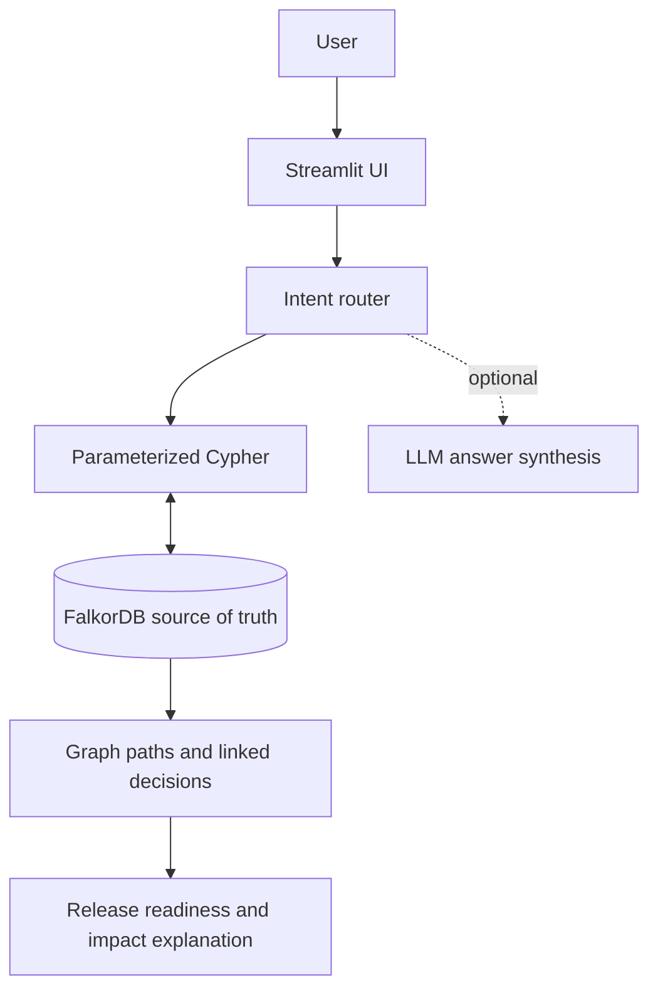

# Graph Hacks 2026 — LaunchLens strategy and verification record

## 1. Official event facts

- **Event:** Graph Hacks: Context for AI Agents, by WeMakeDevs with FalkorDB.
- **Window:** October 15, 2026, 12:01 AM IST to October 18, 2026, 11:59 PM IST.
- **Team size:** solo or up to four participants.
- **Required technology:** FalkorDB must be the primary graph database and a central part of product behavior. A visualization layered over ordinary storage does not qualify.
- **Tracks:** Agents That Act on Connected Data; Agent Memory and Coordination; Company Brain.
- **Required artifacts:** public repository, README with setup and graph model, Cypher queries/algorithms, demo video, a deployment or complete local setup instructions, and selected track.
- **Data and tooling:** public, synthetic, or owned data is permitted; AI coding assistants are allowed with disclosure.
- **Eligibility:** participants need to understand their code and explain architecture, graph model, Cypher, and technical decisions. A submission entirely AI-generated without meaningful participant contribution, verification, or understanding may be rejected.

I could not verify a published numerical judging rubric for this event. Any numeric scores in this document are my own estimates and not official judge scores.

Sources: [official event](https://www.wemakedevs.org/hackathons/falkordb), [official rules](https://www.wemakedevs.org/hackathons/falkordb/rules), [FalkorDB Getting Started](https://docs.falkordb.com/getting-started/).

## 1A. Rubric and competitive landscape check

The official rules page lists eligibility, the load-bearing FalkorDB requirement, submission artifacts, AI disclosure, and participant-understanding rules, but I could not verify a public numerical judging rubric. Therefore the weighted idea scores in this document are planning estimates, not official scores.

Because this hackathon was still running when this package was prepared, I could not verify a prior winning-project list for this same event. A publicly visible current entry at [howdycarter/graph-hacks-falkordb-2026](https://github.com/howdycarter/graph-hacks-falkordb-2026) is **not** treated as a winner; it is a reference point showing the importance of a working demo, FalkorDB as the source of truth, explainable path evidence, and a small coherent agent workflow. LaunchLens's differentiator is the release gate's immediate-versus-later impact analysis, named shortest dependency paths, and decision links attached to affected tasks.

**Judging priorities inferred from official rules and event theme (not an official rubric):** prove removing FalkorDB breaks core behavior; demonstrate a graph path rather than only a prompt/response; show a task-state mutation changing later decisions; make one target-user workflow clear in under three minutes; and submit honest, accessible source/setup/video artifacts.

## 2. Why the product is LaunchLens

**Name:** LaunchLens — Graph-Powered Release Readiness  
**Pitch:** See the blast radius before you ship.  
**User:** small software teams, student project teams, and hackathon teams that need to ship a release with multiple technical prerequisites.  
**Primary track:** Agents That Act on Connected Data.

A flat task list can show open items but hide multi-hop paths into a release gate. A sign-in UI can depend on auth work; integration tests can depend on both UI integration and a ready test environment; release approval can depend on both tests and a security review. The graph can return these paths and attach prior decisions to impacted work.

The differentiator is the **immediate-versus-later impact analysis with named path evidence**. Completing T2 should make T3 and T7 ready immediately, because each has no other unfinished prerequisite. T4 and T6 remain later because they depend on tasks that are still incomplete. The output comes from a reverse relationship traversal plus prerequisite-state evaluation; `allShortestPaths()` and `nodes(path)` provide the actual task-title path, not just a hop count or keyword-search answer.

## 3. Five ideas scored against the event

Estimated 0–10 ratings. Weights: problem impact 25%, originality 20%, graph/technical depth 20%, feasibility 15%, UX/demo 10%, evidence/validation 10%. Weighted total is out of 100.

| Rank | Idea | Impact (25%) | Originality (20%) | Technical (20%) | Feasibility (15%) | UX/demo (10%) | Validation (10%) | Total /100 |
|---:|---|---:|---:|---:|---:|---:|---:|---:|
| 1 | **LaunchLens:** release dependency + decision impact agent | 7.5 | 7.5 | 9.0 | 9.0 | 8.5 | 6.5 | **80.25** |
| 2 | SupplyGraph: trace public package vulnerabilities through dependency graphs | 9.0 | 8.5 | 9.0 | 4.0 | 7.0 | 6.0 | 76.5 |
| 3 | IncidentPath: correlate service alerts and explain root-cause paths | 8.5 | 8.0 | 8.5 | 5.5 | 7.5 | 6.5 | 76.5 |
| 4 | Persistent agent memory with conflict detection and provenance | 8.0 | 7.5 | 8.0 | 7.0 | 8.0 | 6.5 | 76.0 |
| 5 | DecisionLineage: connect policies, project decisions, and evidence | 8.0 | 8.0 | 8.5 | 5.5 | 7.0 | 5.5 | 73.75 |

These are subjective project-selection estimates, not a prediction of winning. LaunchLens ranks first because it gives a concrete technical demonstration with low external dependency risk in the available time.

## 4. Architecture and graph model



- `Project` node owns `Task` nodes via `HAS_TASK`.
- `(Task)-[:DEPENDS_ON]->(Task)` means the left task needs the right task to be done first.
- `Decision` nodes connect to affected tasks using `AFFECTS`.
- No separate file/database stores task state.
- `get_ready_tasks()` finds active tasks with every direct prerequisite marked done.
- `get_blockers_for_task()` follows variable-length dependency paths to find unfinished upstream tasks.
- `get_downstream_impact()` reverses the path to find downstream tasks and computes whether each would become ready immediately if the target completed.
- The release-readiness branch checks the release-approval task and traverses its unfinished prerequisite paths. If a graph status says `done` but unfinished prerequisite paths remain, the agent reports an inconsistent state rather than trusting the status flag. It does not deploy code or grant production certification.

## 5. Evidence and acceptance criteria

### Automated unit/query-contract tests

The package's automated unit tests have been executed in the build environment: **19 passed**. They cover agent intent routing, graph-evidence output, release-gate behavior including inconsistent status, query construction/result mapping, shortest-path return mapping, idempotent seed query structure, rejection of nonexistent dependencies, preventing completion while upstream work remains open, and generation/escaping of the live relationship-map DOT.

These tests do **not** execute Cypher against a live FalkorDB server.

### Live smoke test

`scripts/live_smoke.py` is prepared to run seven live checks on FalkorDB:

1. synthetic release graph exists;
2. ready-task query identifies T2;
3. a multi-hop query finds unfinished upstream blockers of T6;
4. reverse impact identifies T3/T7 as immediately ready and T4/T6 as later;
5. linked decision memory is returned;
6. release approval remains blocked by upstream prerequisites;
7. changing T2 to done changes readiness, then restores T2 to its original state.

The smoke test **has not been executed in the packaging environment** because Docker and the live FalkorDB runtime were not available. Run it from a machine with FalkorDB and the requirements installed:

```powershell
py scripts/live_smoke.py --reset
```

Target is 7/7 passes; do not report it passed until the terminal output confirms that.

## 6. User validation and impact measurement

No external user testing, time-saved study, release-error reduction, or production evaluation has been conducted. Do not claim those outcomes. The most credible small experiment is to ask two project teammates to attempt three tasks: identify the true upstream blocker, explain what would be immediately unblocked, and assess the release gate. Record sample size and actual observations, including failures. If that cannot be done before the deadline, explicitly state that validation remains future work.

## 7. Important remaining risks

| Risk | Required mitigation |
|---|---|
| Live FalkorDB queries may fail despite unit tests | Run the seven-check live smoke test and fix failures. |
| Looks like a generic chatbot/task board | Lead the demo with “Can we release?” and the T2 blast-radius answer, then expose the exact graph paths. |
| Unproven user impact | Do not invent metrics; collect honest quick feedback if feasible. |
| Optional LLM adds variability | Demo deterministic graph-grounded mode by leaving `OPENAI_API_KEY` blank. |
| Submission links absent | Create a public repo and a real, accessible YouTube video; test both incognito. |
| Participant cannot explain AI-generated code | Read and understand `graph_service.py`, `agent.py`, and `queries.cypher`; test and personalize the project before submission. |
| Release task marked approved without real-world proof | UI and README explicitly say graph status is not production-safety certification. |

## 8. Submission demo order

1. Ask “Can we release?” and show the current NOT READY status with upstream blockers.
2. Ask “What gets unblocked if T2 is done?” and show immediate versus later descendants.
3. Show the `DEPENDS_ON` and `AFFECTS` graph evidence.
4. Mark T2 done and show the recommendation changes, then point out that T4 and T6 are still not ready.
5. Recall a linked security/authentication decision.
6. Close with the honest limitation: synthetic demo graph, local hackathon prototype, no claim of production release safety.

## 9. Final package verification status

- Python compilation: **passed**.
- Automated tests: **19 passed**.
- Relationship-map DOT sample: **Graphviz `dot -Tsvg` syntax check passed**; this does not verify Streamlit rendering.
- Live FalkorDB smoke test: **not yet run**.
- Browser end-to-end/manual usability test: **not yet run**. The relationship-map DOT output has automated unit coverage, but the Streamlit rendering has not been visually verified.
- User validation: **not done**.
- GitHub repository, live deployment, and YouTube video: **not created or verified by this package**.

A better source package is not the same as a finished submission. Complete the live verification and publication steps honestly.
