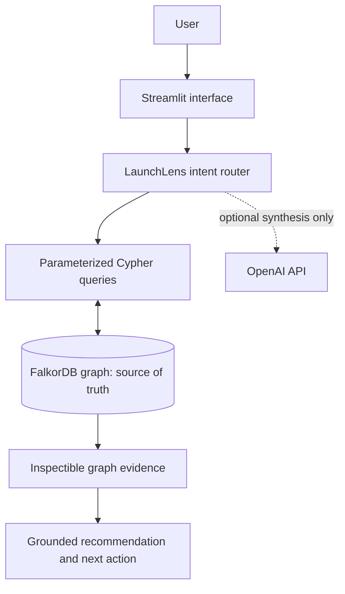
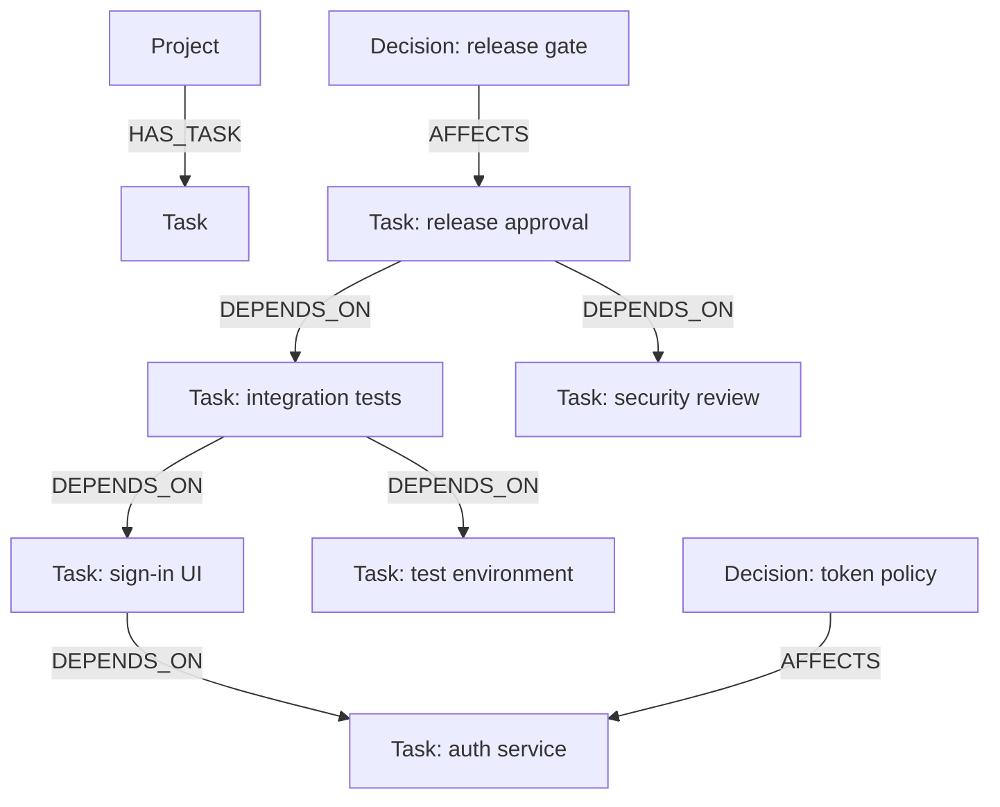

# LaunchLens — Graph-Powered Release Readiness

**See the blast radius before you ship.** LaunchLens is a release-readiness agent for small software teams. It uses FalkorDB to connect implementation work, prerequisites, and release decisions so users can identify what blocks a release, what a task completion would unblock, and which prior decisions apply.

**Hackathon track:** Agents That Act on Connected Data  
**Primary graph database:** FalkorDB  
**Data:** Synthetic example only. No private or restricted data is loaded.

> FalkorDB is the system of record. Readiness, multi-hop blockers, downstream impact, and decision recall all run through Cypher queries over graph relationships. There is no alternative local JSON task database.

## The problem

A release checklist often says a ticket is open without showing its full dependency chain. A team can miss that a UI task depends on unfinished authentication work, that end-to-end tests depend on both UI integration and a test environment, or that release approval depends on both testing and security review.

LaunchLens turns those connections into inspectable graph paths and explains its recommendations.

## What the MVP does

- **Release gate:** surfaces whether the synthetic release candidate is blocked, ready for human review, or marked approved in the graph. If a release task is manually marked done while graph traversal still finds unfinished prerequisites, LaunchLens flags the state as inconsistent instead of trusting the status flag.
- **Next action:** recommends active work whose direct prerequisites are done, ranking in-progress work first, then by priority, and using downstream graph reach as a tie-breaker within those tiers.
- **Multi-hop blockers:** traverses `DEPENDS_ON` paths to identify unfinished prerequisites upstream of a task or release gate.
- **Downstream impact:** reverse-traverses the graph to show what a task completion would affect, how many relationship hops away it is, and which tasks would become ready immediately versus remaining blocked by another prerequisite. It returns explicit shortest dependency paths using FalkorDB's `allShortestPaths()` and `nodes(path)`, so the explanation names the chain rather than showing only a count.
- **Decision recall:** retrieves decisions connected to affected tasks via `AFFECTS` edges.
- **Real state updates:** task status, new tasks, and recorded decisions are written to FalkorDB and change later results. Mutations clear the prior answer so the interface does not leave stale graph evidence visible.
- **Inspectable evidence:** the UI renders a relationship map from task/decision records returned by FalkorDB and exposes raw edges plus evidence for each question.
- **No API key required:** deterministic graph-grounded answers work by default. An optional OpenAI API integration can synthesize a response using retrieved graph evidence, but is not required for the core workflow.

The synthetic scenario models an authentication release:

- T1: Agree on the authentication contract — done
- T2: Implement authentication service — in progress; depends on T1
- T3: Integrate sign-in UI — depends on T2
- T4: Run end-to-end integration tests — depends on T3 and T5
- T5: Provision the test environment — done
- T7: Complete authentication security review — depends on T2 and T5
- T6: Approve the release candidate — depends on T4 and T7

This creates the core demo moment: if T2 is completed, T3 and T7 can become ready immediately; T4 and T6 remain later in the chain. The exact answer is computed from relationship paths and prerequisite states.

## Architecture



### Graph data model



Node labels:

| Label | Important properties | Purpose |
|---|---|---|
| `Project` | `id`, `name`, `description`, `created_at` | Owns and groups project tasks |
| `Task` | `id`, `title`, `description`, `status`, `priority`, `owner`, `due_date`, `updated_at` | A release work item and its state |
| `Decision` | `id`, `title`, `details`, `created_at` | Durable decision memory |

Relationships:

- `(Project)-[:HAS_TASK]->(Task)` — task belongs to the release project.
- `(Task)-[:DEPENDS_ON]->(Task)` — the source task cannot be considered ready until the target prerequisite is done.
- `(Decision)-[:AFFECTS]->(Task)` — the decision provides context for the linked work.

### Important Cypher operations

The full queries are documented in [`queries.cypher`](queries.cypher). The readiness query:

```cypher
MATCH (p:Project {id: $project_id})-[:HAS_TASK]->(t:Task)
WHERE t.status IN ['todo', 'in_progress']
OPTIONAL MATCH (t)-[:DEPENDS_ON]->(dep:Task)
WITH t, collect(dep) AS deps
WHERE all(dep IN deps WHERE dep.status = 'done')
RETURN t.id, t.title, t.status, t.priority, size(deps) AS dependency_count;
```

The multi-hop blocker query follows prerequisite paths:

```cypher
MATCH (t:Task {id: $task_id})-[:DEPENDS_ON*1..]->(dep:Task)
WHERE dep.status <> 'done'
RETURN dep.id, dep.title, dep.status;
```

The impact query reverses the relationship direction to identify downstream tasks:

```cypher
MATCH (target:Task {id: $task_id}), (downstream:Task)
WHERE downstream.status <> 'done' AND downstream.id <> target.id
MATCH path = allShortestPaths((downstream)-[:DEPENDS_ON*1..]->(target))
WITH downstream, target, length(path) AS distance,
     collect(DISTINCT [n IN nodes(path) | n.title]) AS dependency_paths
OPTIONAL MATCH (downstream)-[:DEPENDS_ON]->(direct_dep:Task)
WITH downstream, target, distance, dependency_paths, collect(direct_dep) AS direct_deps
WITH downstream, target, distance, dependency_paths,
     (downstream.status IN ['todo', 'in_progress'] AND
      all(dep IN direct_deps WHERE dep.status = 'done' OR dep.id = target.id)) AS ready_if_target_done
OPTIONAL MATCH (d:Decision)-[:AFFECTS]->(downstream)
RETURN downstream.id, downstream.title, downstream.status, distance, dependency_paths,
       ready_if_target_done, collect(DISTINCT d.title) AS linked_decisions
ORDER BY distance, downstream.id;
```

The query uses `allShortestPaths()` and `[n IN nodes(path) | n.title]` to return a named shortest path for the explanation. The `ready_if_target_done` field prevents the agent from claiming every downstream task becomes immediately ready. Only direct dependents whose other direct prerequisites are already done receive that designation. FalkorDB path-function reference: <https://docs.falkordb.com/cypher/functions.html>.

## Quick start

### Prerequisites

- Docker Desktop with Docker Compose
- Python 3.10+ (needed for the local smoke-test command and tests)
- A browser

### Option A: full application in Docker Compose

```powershell
Copy-Item .env.example .env
docker compose up --build
```

Open:

- LaunchLens: <http://localhost:8501>
- FalkorDB Browser: <http://localhost:3000>

The graph is persisted in the `falkordb_data` Docker volume. Stop services with `docker compose down`. To wipe the volume as well, run `docker compose down -v`; this deletes saved graph data.

### Option B: FalkorDB in Docker, Python app on the host

Start a terminal in the project folder and run:

```powershell
docker compose up -d falkordb
py -m venv .venv
.venv\Scripts\Activate.ps1
py -m pip install -r requirements.txt
Copy-Item .env.example .env
streamlit run app.py
```

On macOS/Linux, activate with `source .venv/bin/activate` and use the appropriate Python command. If PowerShell blocks activation, use the Docker Compose option or run the venv's Python executable directly.

### Optional LLM synthesis

Set `OPENAI_API_KEY` in `.env` to enable response synthesis. The app still queries FalkorDB first; without the key, deterministic graph-grounded answers work locally. Never commit `.env` or any secret.

## Verification

### Automated tests

Install dependencies, then run:

```powershell
py -m pytest -q
```

The 19 unit tests cover answer routing, release-readiness behavior including inconsistent `done` status, query construction/result mapping, named shortest paths, idempotent seed query structure, invalid dependency rejection, protection against marking a task done while an upstream prerequisite is unfinished, and relationship-map DOT generation/escaping.

### Live database smoke test

Run this only against a disposable LaunchLens demo graph; `--reset` deletes all nodes in the configured graph first:

```powershell
py scripts/live_smoke.py --reset
```

The smoke test checks that seed data exists, graph readiness works, multi-hop blockers are found, reverse impact correctly distinguishes immediate from later readiness, decision memory can be retrieved, the release gate remains blocked while prerequisites are unfinished, and updating T2 changes task readiness before the test restores the original status.

**Verification status in the packaged development environment:** Python compilation, 19 unit tests, and a generated Graphviz DOT syntax check were executed successfully. The live smoke test and browser-based end-to-end flow were not executed in the packaging environment because Docker and the FalkorDB runtime were unavailable there. Run both on the target computer before submitting or describing the live integration as verified.

## Demo walkthrough

See [`DEMO_SCRIPT.md`](DEMO_SCRIPT.md). The most compelling flow is:

1. Ask “Can we release?” and show that LaunchLens says **NOT READY**, with upstream prerequisites retrieved from FalkorDB.
2. Open the live relationship map and explain the stored `DEPENDS_ON` and `AFFECTS` edge directions.
3. Ask “What gets unblocked if T2 is done?” Show T3 and T7 as immediately ready, while T4 and T6 remain downstream.
4. Expand raw graph evidence and show the exact `DEPENDS_ON` and `AFFECTS` relationships.
5. Update T2 to `done` in the Task board, rerun the readiness question, and show the state transition persisted in FalkorDB.
6. Retrieve the authentication token decision to demonstrate graph-linked memory.

## Limitations and scope

- The starter graph is fictional data, not evidence of a live company's real release process.
- No user study, time-saved measurement, production benchmark, or security certification has been conducted.
- “Approved” reflects the task status recorded in the graph after checking that no unfinished prerequisite path remains; it is not a guarantee that a release is safe. If status and dependency evidence conflict, LaunchLens reports the inconsistency.
- The optional LLM may summarize retrieved context but does not execute deployments or approve releases.
- The app is a hackathon prototype and is not designed for multi-tenant production use.

## Project structure

- `app.py` — Streamlit UI and user actions
- `graph_service.py` — FalkorDB client, synthetic graph, graph queries, and write operations
- `agent.py` — intent routing, deterministic graph-grounded answers, optional LLM synthesis
- `visualization.py` — safely generate the live relationship map from queried graph rows
- `queries.cypher` — important graph queries for review
- `scripts/live_smoke.py` — live FalkorDB smoke checks
- `tests/` — unit, query-contract, release-gate regression, and relationship-map tests
- `VALIDATION_PLAN.md` — short, honest user-validation protocol for measuring task success
- `SUBMISSION_FIELDS.md` — draft responses for the hackathon submission form
- `AI_DISCLOSURE.md` — disclosure of AI coding assistance

## References

- [Graph Hacks official event and tracks](https://www.wemakedevs.org/hackathons/falkordb)
- [Graph Hacks official rules](https://www.wemakedevs.org/hackathons/falkordb/rules)
- [FalkorDB Getting Started](https://docs.falkordb.com/getting-started/)
- [FalkorDB Python client](https://github.com/FalkorDB/falkordb-py)
